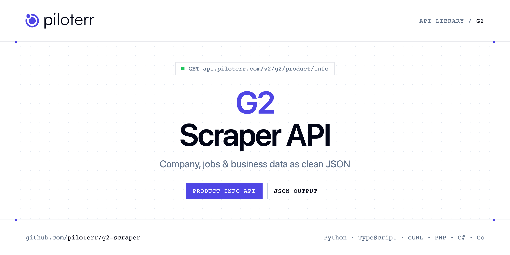

<p align="center">
  <a href="https://www.piloterr.com"></a>
</p>

# G2 Scraper API

[](https://discord.gg/CFj3ph8aHU) [](https://app.piloterr.com) [](https://app.piloterr.com/openapi) [](LICENSE)

The **Piloterr G2 Scraper API** lets you extract public data from G2 as **clean, structured JSON** — no proxies, headless browsers or HTML parsing to maintain. Endpoints available in production:

- **G2 Product Info API** — Read a G2 product reviews page: rating, pricing, categories, alternatives, screenshots, and the reviews shown on the page.

Use it for lead generation, CRM enrichment, market mapping, investment research or job market analytics.

| Endpoint | Path | Credits | What you get |
|---|---|---|---|
| [G2 Product Info API](#g2-product-info-api) | `/v2/g2/product/info` | 2 | Read a G2 product reviews page |

## Table of contents

- [How it works](#how-it-works)
- [G2 Product Info API](#g2-product-info-api)
- [Code examples in other languages](#code-examples-in-other-languages)
- [Practical use cases](#practical-use-cases)
- [Why Piloterr?](#why-piloterr)
- [FAQ](#faq)
- [Related scrapers](#related-scrapers)
- [Support](#support)

## How it works

1. **Create a free Piloterr account** and copy your API key from the [dashboard](https://app.piloterr.com).
2. **Send a `GET` (or `POST`) request** to `https://api.piloterr.com/v2/...` with the header `x-api-key: YOUR_API_KEY`.
3. **Receive structured JSON** — Piloterr handles rendering, proxies, retries and parsing.

```bash
export PILOTERR_API_KEY="your-api-key"
pip install requests        # Python
# TypeScript: Node.js 18+ (native fetch), run with `npx tsx file.ts`
```

> Every endpoint accepts both `GET` (query string) and `POST` (JSON body with the same fields).

## G2 Product Info API

Read a G2 product reviews page: rating, pricing, categories, alternatives, screenshots, and the reviews shown on the page.

`GET | POST https://api.piloterr.com/v2/g2/product/info` · **2 credits per request** · [Full reference](https://app.piloterr.com/openapi)

### Request parameters

| Parameter | Type | Required | Description |
|---|---|---|---|
| `query` | string | ✅ | Product slug or a www.g2.com product URL. |
| `nps_score` | number | — | Keep reviews of one star rating, from 1 to 5. Omit it to read the unfiltered reviews page. |
| `return_page_source` | boolean | — | Return the rendered HTML instead of the parsed product. |

### Python example

```python
import json
import os
import requests

response = requests.get(
    "https://api.piloterr.com/v2/g2/product/info",
    headers={"x-api-key": os.environ["PILOTERR_API_KEY"]},
    params={
        "query": "postman",
    },
    timeout=60,
)
response.raise_for_status()
data = response.json()

print(json.dumps(data, indent=2, ensure_ascii=False)[:2000])
```

### TypeScript example

```typescript
type G2ProductInfo = {
  rating?: number;
  reviews?: {
    reviewer?: {
      link?: string;
      name?: string;
      industry?: string;
      job_title?: string;
      company_size?: string;
    };
    review_id?: number;
    review_link?: string;
    publish_date?: string;
    review_title?: string;
    review_rating?: number;
    review_question_answers?: {
      answer?: string;
      question?: string;
    }[];
  }[];
  what_is?: string;
  category?: string;
  breadcrumb?: {
    url?: string;
    name?: string;
    position?: number;
  }[];
  categories?: string[];
  company_id?: number;
  is_claimed?: boolean;
  product_id?: number;
  screenshots?: {
    url?: string;
    title?: string;
    description?: string;
  }[];
  alternatives?: {
    rating?: number;
    product_link?: string;
    product_name?: string;
    reviews_count?: number;
  }[];
  product_link?: string;
  product_logo?: string;
  product_name?: string;
  product_slug?: string;
  product_type?: string;
  pricing_plans?: {
    name?: string;
    price?: unknown;
    price_display?: string;
  }[];
  reviews_count?: number;
  discussions_link?: string;
  star_distribution?: {
    "1"?: number;
    "2"?: number;
    "3"?: number;
    "4"?: number;
    "5"?: number;
  };
  product_description?: string;
};

const params = new URLSearchParams({
  "query": "postman",
});

const response = await fetch(`https://api.piloterr.com/v2/g2/product/info?${params}`, {
  headers: { "x-api-key": process.env.PILOTERR_API_KEY! },
});
if (!response.ok) throw new Error(`Piloterr error ${response.status}: ${await response.text()}`);

const data = (await response.json()) as G2ProductInfo;

console.log(JSON.stringify(data, null, 2).slice(0, 2000));
```

<details>
<summary><b>POST variant</b></summary>

```http
POST https://api.piloterr.com/v2/g2/product/info
x-api-key: YOUR_API_KEY
Content-Type: application/json

{"query": "postman"}
```
</details>

### Output example

Example response from the API reference, abridged — real values depend on the page you scrape.

```json
{
  "rating": 4.6,
  "reviews": [
    {
      "reviewer": {
        "link": "example",
        "name": "example",
        "industry": "example",
        "job_title": "example",
        "company_size": "example"
      },
      "review_id": 13694235,
      "review_link": "https://www.g2.com/products/postman/reviews#postman-review-13694235",
      "publish_date": "2026-10-04",
      "review_title": "Effortless API Testing with Team Collaboration",
      "review_rating": 4,
      "review_question_answers": [
        {}
      ]
    }
  ],
  "what_is": "Postman is the world’s leading API platform, used by more than 40 million developers and 500,000 organizations to build, test, and manage…",
  "category": "API Platforms",
  "breadcrumb": [
    {
      "url": "https://www.g2.com/",
      "name": "Home",
      "position": 1
    },
    {
      "url": "https://www.g2.com/categories/api-platforms",
      "name": "API Platforms",
      "position": 2
    }
  ],
  "categories": [
    "Service Virtualization",
    "API Platforms"
  ],
  "company_id": 16505,
  "is_claimed": true,
  "product_id": 20238,
  "screenshots": [
    {
      "url": "https://images.g2crowd.com/cdn-cgi/image/width=1200,height=1200,fit=scale-down,format=auto,onerror=redirect,/https://images.g2crowd.com/u…",
      "title": "Postman Demo - API Design",
      "description": "You can design your API specifications in Postman using OpenAPI, RAML, GraphQL, or SOAP formats."
    }
  ],
  "alternatives": [
    {
      "rating": 4.4,
      "product_link": "https://www.g2.com/products/mulesoft-anypoint-platform/reviews",
      "product_name": "MuleSoft Anypoint Platform",
      "reviews_count": 894
    },
    {
      "rating": 4.7,
      "product_link": "https://www.g2.com/products/workato/reviews",
      "product_name": "Workato",
      "reviews_count": 858
    }
  ],
  "product_link": "https://www.g2.com/products/postman/reviews",
  "product_logo": "https://images.g2crowd.com/uploads/product/image/social_landscape/social_landscape_fd527e1fc777d9e31b2a28e8d3c959a4/postman.jpg",
  "product_name": "Postman",
  "product_slug": "postman",
  "product_type": "Software",
  "pricing_plans": [
    {
      "name": "Free Plan",
      "price": null,
      "price_display": "Free"
    },
    {
      "name": "Basic Plan",
      "price": 14,
      "price_display": "$14.00"
    }
  ],
  "reviews_count": 1795,
  "discussions_link": "https://www.g2.com/products/postman/discuss",
  "star_distribution": {
    "1": 0,
    "2": 0,
    "3": 0,
    "4": 16,
    "5": 82
  },
  "product_description": "Postman is the world’s leading API platform, used by more than 40 million developers and 500,000 organizations to build, test, and manage…"
}
```

### Response fields

| Field | Type | Description |
|---|---|---|
| `rating` | number |  |
| `reviews[]` | object[] |  |
| `reviews[].reviewer` | object |  |
| `reviews[].review_id` | integer |  |
| `reviews[].review_link` | string |  |
| `reviews[].publish_date` | string |  |
| `reviews[].review_title` | string |  |
| `reviews[].review_rating` | integer |  |
| `reviews[].review_question_answers[]` | object[] |  |
| `what_is` | string |  |
| `category` | string |  |
| `breadcrumb[]` | object[] |  |
| `breadcrumb[].url` | string |  |
| `breadcrumb[].name` | string |  |
| `breadcrumb[].position` | integer |  |
| `categories` | string[] |  |
| `company_id` | integer |  |
| `is_claimed` | boolean |  |
| `product_id` | integer |  |
| `screenshots[]` | object[] |  |
| `screenshots[].url` | string |  |
| `screenshots[].title` | string |  |
| `screenshots[].description` | string |  |
| `alternatives[]` | object[] |  |
| `alternatives[].rating` | number |  |

## Code examples in other languages

Ready-to-run examples live in the [`examples/`](examples) folder. Each one reads your key from the `PILOTERR_API_KEY` environment variable.

| Language | Product Info |
|---|---|
| cURL (Bash) | [`product-info`](examples/curl/product_info.sh) |
| PHP | [`product-info`](examples/php/product_info.php) |
| C# | [`product-info`](examples/csharp/ProductInfo.cs) |
| Go | [`product-info`](examples/go/product_info.go) |
| Java | [`product-info`](examples/java/ProductInfoExample.java) |
| Ruby | [`product-info`](examples/ruby/product_info.rb) |
| Node.js | [`product-info`](examples/nodejs/product_info.mjs) |

## Practical use cases

- **Lead generation** — Build target account lists from public company data.
- **CRM enrichment** — Keep firmographics, websites and descriptions up to date.
- **Market mapping** — Map competitors and segments across countries and industries.
- **Investment research** — Screen companies, funding and signals for deal flow.
- **Job market analytics** — Track hiring, roles and salaries where available.

## Why Piloterr?

- **No infrastructure** — no proxies, headless browsers or CAPTCHA solving to run yourself.
- **Structured JSON** — stable, documented fields instead of brittle HTML selectors.
- **Pay per request** — transparent credit cost per endpoint, failed requests are retried for you.
- **One API key, hundreds of sources** — G2 plus many other e-commerce, search and company data endpoints in the [Piloterr library](https://www.piloterr.com/library).
- **Any language** — plain HTTPS + JSON, with examples for Python, TypeScript, cURL, PHP, C#, Go, Java, Ruby and Node.js.

## FAQ

### Is it legal to scrape G2?

Collecting publicly available data is generally allowed in many jurisdictions, but rules depend on your country, the data you collect and how you use it. Avoid personal data unless you have a lawful basis, respect the website's terms where they apply, and get legal advice for your specific use case. This is not legal advice.

### Do I need proxies or a headless browser?

No. Piloterr handles rendering, proxy rotation and retries on its side. You only send an HTTPS request with your `x-api-key` header and receive JSON.

### How much does a request cost?

Credits per call: `/v2/g2/product/info` **2**. See the [Piloterr website](https://www.piloterr.com) for plans.

### What data does the G2 API return?

Each endpoint returns structured JSON: **G2 Product Info** — `rating`, `reviews[]`, `reviews[].reviewer`, `reviews[].review_id`, `reviews[].review_link`, `reviews[].publish_date`.

### Can I get the raw HTML instead of JSON?

Yes. Set `return_page_source=true` and the response becomes `{"result": "..."}` with the page source.

### Which languages are supported?

Any language that can make an HTTP request. This README shows Python and TypeScript; the [`examples/`](examples) folder contains cURL, PHP, C#, Go, Java, Ruby and Node.js.

## Related scrapers

- [Company Database Scraper API](https://github.com/piloterr/company-data-api)
- [Crunchbase Scraper API](https://github.com/piloterr/crunchbase-scraper)
- [Europages Scraper API](https://github.com/piloterr/europages-scraper)
- [Fiverr Scraper API](https://github.com/piloterr/fiverr-scraper)
- [github-scraper](https://github.com/piloterr/github-scraper)
- [Glassdoor Scraper API](https://github.com/piloterr/glassdoor-scraper)
- [All Piloterr scrapers on GitHub](https://github.com/piloterr)

## Support

- 💬 Join the [Piloterr Discord](https://discord.gg/CFj3ph8aHU) to ask questions and share what you build.
- 📚 Browse the [API reference (OpenAPI)](https://app.piloterr.com/openapi) and the [Piloterr library](https://www.piloterr.com/library).
- 🔑 [Get your API key](https://app.piloterr.com).

---

<p align="center">
  <a href="https://www.piloterr.com">
    <picture>
      <source media="(prefers-color-scheme: dark)" srcset="images/logo-dark.svg">
      
    </picture>
  </a>
  <br>
  <sub>Built by <a href="https://www.piloterr.com">Piloterr</a> — web scraping APIs for e-commerce, search, real estate and more, one API key.</sub>
</p>

<sub>G2 is a trademark of its respective owner. This repository is not affiliated with or endorsed by G2. Examples are released under the MIT license.</sub>
